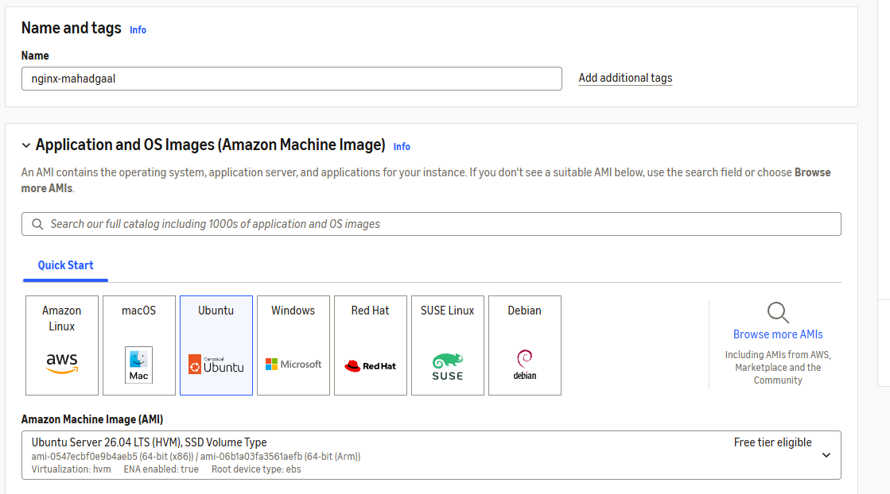
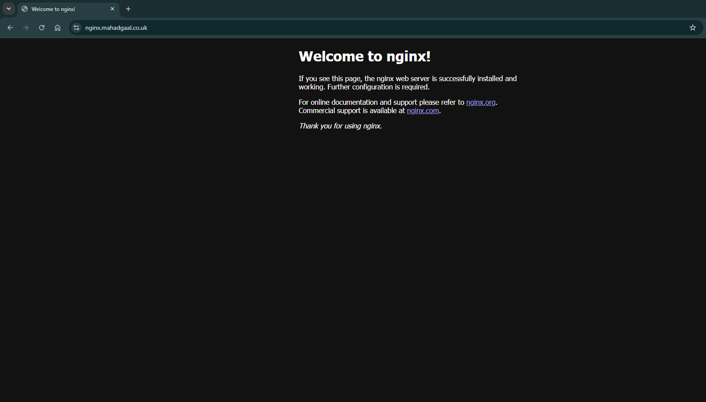
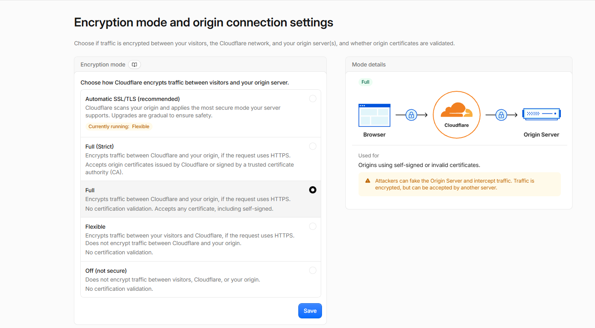

# Networking: Domain + EC2 + DNS

Core assignment: buy a domain, deploy NGINX on an EC2 instance, point an A record at it, and load the default NGINX page over my own domain.

## What I built

```
Browser --> Cloudflare (DNS + proxy) --> EC2 instance (Ubuntu + NGINX)
```

| Component | Detail |
|-----------|--------|
| Domain | `mahadgaal.co.uk`, registered with Cloudflare Registrar |
| Hostname | `nginx.mahadgaal.co.uk` |
| DNS | A record `nginx` pointing at the EC2 public IPv4, managed in Cloudflare |
| Compute | EC2 `t3.micro`, Ubuntu Server 26.04 LTS, `us-east-1` |
| Web server | NGINX default site, enabled at boot with systemd |
| Firewall | Security group `launch-wizard-1`: SSH (22) from my IP only, HTTP (80) from anywhere |
| Cloudflare | Record proxied, SSL/TLS mode set to Flexible |

## Screenshots

### 1. Configure EC2 Instance in AWS 




As you can see per message below "Rules with source of 0.0.0.0/0 allow all IP addresses to access your instance. We recommend setting security group rules to allow access from known IP
addresses only" . I configure an Elastic IP which is mention on .4 if you scroll down. 


## Installing and Configuring NGINX

The next step was to install NGINX on my EC2 instance.

### 2. Install and Start NGINX

First, I updated the package repositories, installed NGINX and configured the service to start automatically.

```bash
sudo apt update
sudo apt install -y nginx
sudo systemctl enable nginx
sudo systemctl start nginx
sudo systemctl status nginx
```

### 3. Configure DNS Records in Cloudflare

Once NGINX was installed and running, I added an **A record** in my Cloudflare dashboard, pointing my domain to my EC2 instance's public IP address.


### 4. Configure an AWS Elastic IP

I also noticed that my EC2 instance was using a dynamic public IP address, which could change if the instance was stopped and started again.

To prevent this, I allocated and associated an **Elastic IP** with my EC2 instance. This ensures that my NGINX web server retains a consistent public IP address.

I've intentionally blurred the IP address in the screenshots to avoid exposing it.


### 5. Final Result – NGINX Running on My Custom Domain

Finally, I successfully accessed my NGINX web server using my own custom domain.




### Troubleshooting

**Cloudflare SSL/TLS Full mode option**




## What I learnt

- **A records** map a hostname to an IPv4 address. The record is what turns `nginx.mahadgaal.co.uk` into my server.
- **Security groups** are a stateful firewall around the instance. Each service needs its own inbound rule (SSH 22, HTTP 80, HTTPS 443), and nothing is open by default.
- **Source IP matters.** Restricting SSH to my IP stops anyone else from even attempting a login, and cuts brute-force noise.
- **IPv4 vs IPv6.** A rule for an IPv6 address does not match an IPv4 connection, and AWS will not convert one rule type into the other.
- **Public vs private addresses.** The `172.31.x.x` address only works inside the VPC. DNS has to point at the public IPv4, which changes when an instance is stopped and started unless an Elastic IP is attached.
- **Regions.** Resources live in one region (`us-east-1` here), and the console only shows the region selected in the top-right.
- **Cloudflare proxy.** With the proxy on, `nslookup` returns Cloudflare addresses, not my server's. Cloudflare's SSL/TLS mode decides how it connects to the origin.
- **Key pairs.** The private `.pem` file is downloaded once, must have restricted permissions, and must never be committed to Git.

## Challenges and how I solved them

### 1. SSH connection timed out

**Symptom:** `ssh: connect to host ... port 22: Connection timed out`.

**Diagnosis:** `Test-NetConnection <ip> -Port 22` returned `TcpTestSucceeded : False`. (The ping failure was expected, because EC2 blocks ICMP by default.) A timeout rather than "Permission denied" meant packets were not reaching the instance, so the key was not the problem. There were two causes:

1. **Wrong IP.** I was connecting to my own public IP instead of the instance's **Public IPv4 address** from the EC2 console.
2. **IPv6 rule.** The "My IP" option saved my IPv6 address, but my SSH connection went out over IPv4, so the rule never matched.

**Fix:** I replaced the SSH rule with an IPv4 rule and used the instance's correct public IP. SSH now works with the source restricted to my IP.

### 2. Browser "Connect" button fails with a restricted SSH rule

EC2 Instance Connect in the browser connects from AWS's own IP ranges, not from my PC, so an SSH rule limited to my IP blocks it. That is the rule working as intended. I log in from PowerShell instead.

### 3. Cloudflare error 522 (connection timed out)

**Symptom:** the domain showed Cloudflare's 522 page: browser OK, Cloudflare OK, host error. The NGINX page loaded fine when I went directly to the instance's IP, so the server itself was healthy.

**Cause:** with the proxy on, Cloudflare was trying to reach the origin over HTTPS on port 443. The instance had no HTTPS rule and no certificate, so the connection timed out.

**Fix:** I set SSL/TLS mode to **Flexible**, so Cloudflare connects to the origin over HTTP on port 80, which was already open. The page loaded straight away.

**Trade-off:** Flexible encrypts visitor-to-Cloudflare traffic but not Cloudflare-to-origin traffic. That is acceptable for a default NGINX page but not for anything real.

## Security notes

- SSH is restricted to my IP; only HTTP (80) is open to the internet.
- The `.pem` key stays out of the repo (`*.pem` is in `.gitignore`).
- Screenshots were checked for my home IP and AWS account ID before committing.

## Cleanup

When finished, terminate the instance and release any Elastic IP to avoid ongoing charges. A stopped instance still pays for its storage.

## Next steps

- Open port 443, install a Let's Encrypt certificate with Certbot, and move Cloudflare to **Full (strict)** so the whole path is encrypted and verified.
- Attach an Elastic IP so the A record survives stop/start.
- Restrict port 80 to Cloudflare's IP ranges so the origin can only be reached through the proxy.

See [commands.md](commands.md) for the commands I used and [notes.md](notes.md) for my notes.
